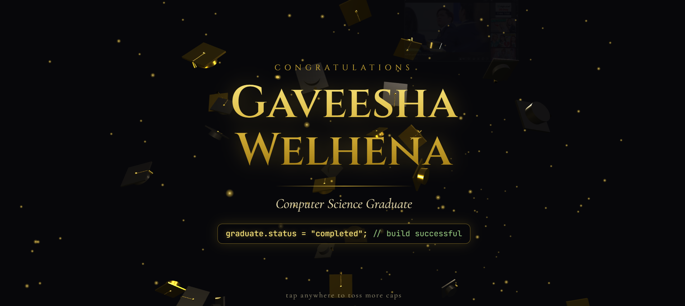

<div align="center">

</div>

# Graduation Cap Toss 🎓

A small 3D graduation gift page built with Three.js. Black and gold grad caps launch into the air, spin, and fall in a loop over a dark background with drifting gold sparks. Tap or click anywhere to toss extra caps from that spot.

Made for Gaveesha Welhena, Computer Science graduate.

## Files

```
gaveesha-graduation/
├── index.html   # the whole project: HTML, CSS and JavaScript in one file
└── README.md
```

## Run it

Just open `index.html` in a browser. No build step, no install.

It needs an internet connection the first time because it loads two things from a CDN:

- Three.js r128 from cdnjs
- Fonts (Cinzel, Cormorant Garamond, JetBrains Mono) from Google Fonts

If the fonts fail to load, it falls back to Georgia and a system monospace font and still works.

## Share it as a link

Any static host works:

- **Netlify Drop**: drag the folder onto https://app.netlify.com/drop
- **GitHub Pages**: push the folder to a repo, then Settings, Pages, deploy from the main branch
- **Vercel**: `npx vercel` inside the folder

## Customize

Everything is in `index.html`.

| What | Where |
| --- | --- |
| Name | the `<h1>` tag (`Gaveesha<br>Welhena`) |
| Degree line | `<p class="sub">` |
| Code line | `<div class="code">` (the green part is the `<span class="c">` comment) |
| Small top text | `<p class="eyebrow">` |
| Hint text at the bottom | `<div class="hint">` |
| Gold colors | `--gold` and `--gold-light` in `:root`, plus the material colors `0xd4af37` and `0xf0cf65` in the script |
| Dark cap color | `darkMat` color `0x1b1b20` |
| Number of looping caps | the `for (var i = 0; i < 26; i++)` line |
| Caps per tap | the `for (var k = 0; k < 8; k++)` line inside `toss` |
| Fall speed | `G = 6` (higher is faster) |
| Launch height | `c.vy` line: `9 + Math.random() * 4.5` in `launch` |
| Spark count | `var N = 260` |

## How it works

- **Caps**: each cap is a `THREE.Group` made of a flat board, a cylinder base, a button, a cord and a tassel. Half are gold metal, half are dark metal.
- **Motion**: simple physics per cap (velocity, gravity, random spin). Looping caps respawn at the bottom when they fall out of view. Caps from taps are removed once they fall.
- **Tap to toss**: the pointer position is unprojected onto the z = 0 plane so caps launch from where you tapped.
- **Sparks**: a `THREE.Points` cloud with a radial-gradient canvas texture and additive blending.
- **Text**: a normal HTML overlay with `pointer-events: none`, so taps pass through to the canvas.

## Make it work offline

Download `three.min.js` (r128) and the fonts, put them next to `index.html`, and change the `<script src>` and the Google Fonts `<link>` to point at the local files.

## License

Do whatever you like with it. Three.js is MIT licensed.
